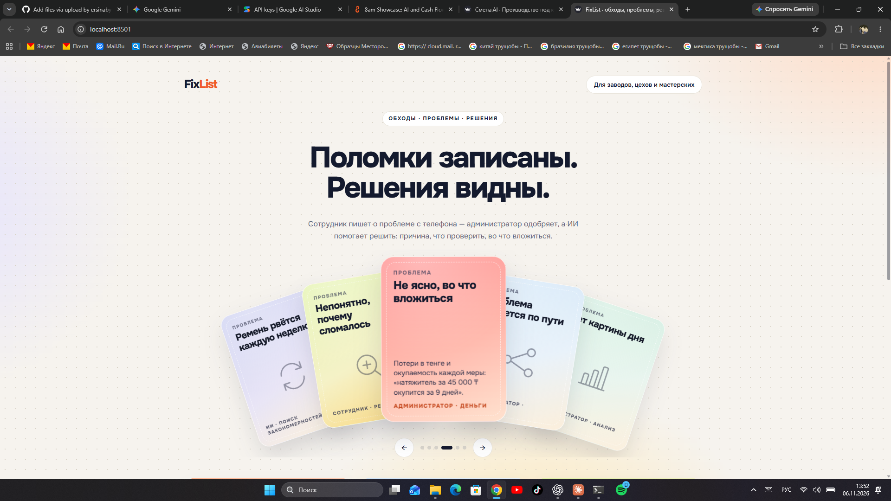
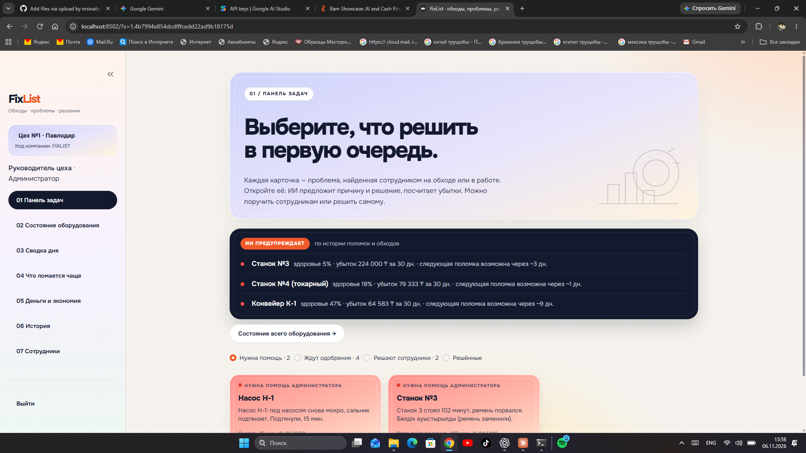

# FixList — обходы, проблемы, решения

[](https://github.com/ERA216/Hackathon/actions/workflows/ci.yml)
[](LICENSE)


**Веб-сервис для производств: сотрудник записывает обход оборудования с телефона, найденные проблемы становятся карточками у администратора, а ИИ помогает их решить, считает убытки и заранее предупреждает, какой станок скоро сломается.**

[Быстрый старт](#быстрый-старт) · [Проблема и решение](#проблема-и-решение) · [Архитектура](docs/architecture.md) · [План развития](docs/roadmap.md)

[](assets/landing.png)

## Хакатон «ИИ-приложение» · Торайгыров университет, 6 ноября 2026

| Участник | Роль | Контакт |
| --- | --- | --- |
| _впишите имя_ | Backend и ИИ | _GitHub_ |
| _впишите имя_ | Интерфейс | _GitHub_ |
| _впишите имя_ | Данные и презентация | _GitHub_ |

## Проблема и решение

1. **Поломки пишут в тетрадь или в мессенджер.** Записи никто не сводит вместе.
   → Сотрудник сдаёт **отчёт об обходе** или пишет о проблеме своими словами с телефона. Всё уходит в базу компании.
2. **Одна и та же поломка повторяется.** Никто не замечает, что станок ломается всё чаще.
   → Код считает **ритм поломок и здоровье каждого аппарата**, прогнозирует следующую поломку, а блок «ИИ предупреждает» показывает это заранее.
3. **Непонятно, почему сломалось и что проверить.**
   → **Анализ ИИ**: вероятные причины из базы типовых причин и конкретные проверки. Администратор применяет решение ИИ или поручает задачу сотрудникам.
4. **Не ясно, во что вложиться.**
   → **Деньги и экономия**: убытки в тенге и окупаемость каждой меры («натяжитель за 45 000 ₸ окупится за ~9 дней»).

## Почему ИИ, а не просто чат-бот

- **Данные копятся.** Сервис помнит историю обходов и поломок каждого станка. Общий чат-бот её не знает.
- **Ответы ИИ проверяются кодом.** Станок — только из справочника, минуты простоя — только из текста, причины и меры — только из базы, числа в ответах сверяются с данными.
- **Деньги и прогнозы считает код**, а не модель: убытки, окупаемость, следующая поломка.
- **Устойчивость.** Если ИИ недоступен (нет сети, лимит, перегрузка), сервис переключает модель или ключ, а затем работает по правилам и не падает.

## Возможности

- Отчёт об обходе: «норма / замечание / проблема» по каждому аппарату; проблемы сразу становятся карточками
- Разбор свободного текста на русском и казахском: станок, поломка, простой, запчасти
- Анализ ИИ: вероятные причины из базы (26 типовых причин) и что проверить
- Панель задач администратора: карточки по статусам, «Применить решение ИИ», «Поручить сотрудникам»
- Сотрудник решает поручённую задачу с анализом ИИ или передаёт её администратору кнопкой «Нужна помощь»
- Состояние оборудования: здоровье, убытки за 30 дней, прогноз следующей поломки с объяснением
- «ИИ предупреждает»: блок сам обновляется каждые 15 секунд
- Сводка дня от ИИ с проверкой чисел и названий станков
- «Спросить ИИ»: чат, который отвечает только по данным базы компании
- Деньги и экономия: меры из базы и окупаемость каждой
- Компании и сотрудники: заявка на подключение, вход по коду компании, логину и PIN, данные компаний разделены

[](assets/admin-board.png)

## Стек

| Слой | Технологии |
| --- | --- |
| Интерфейс | Streamlit, свой CSS (шрифт Onest, пастельные карточки), анимированная колода на HTML/JS |
| ИИ | Gemini Flash-Lite через REST; поддерживаются OpenAI и Anthropic; JSON-вывод и проверка схемой Pydantic |
| Логика и аналитика | Python, pandas |
| Данные | SQLite; справочники оборудования, причин и мер — JSON |
| Безопасность | ключи в `.env`, PIN в виде хеша PBKDF2-SHA256, подписанный токен сессии, `company_id` во всех таблицах |
| Тесты и CI | 20 автотестов без сети и ключа, GitHub Actions |

## Архитектура

```
 Сотрудник (телефон)                         Администратор
   │ отчёт об обходе / текст                      ▲  карточки, предупреждения, сводка, чат
   ▼                                              │
 ┌──────────────────── FixList (app.py, Streamlit) ─────────────────────┐
 │  extract.py ──► ИИ извлекает поля ──► код проверяет (справочник, текст)│
 │  diagnose.py ─► причины только из data/causes.json                     │
 │  analytics.py ► убытки, ритм поломок, здоровье, прогноз (только код)   │
 │  advisor.py ──► меры из data/measures.json + окупаемость (код)         │
 │  briefing.py / assistant.py ► сводка и чат ИИ, числа сверяются с базой │
 │  llm.py ──────► Gemini: повторы, смена модели и ключа, резервный режим │
 └──────────────────────────────┬────────────────────────────────────────┘
                                ▼
                      SQLite (данные по компаниям)
```

Подробно: [docs/architecture.md](docs/architecture.md)

## Быстрый старт

Нужен Python 3.11+.

```sh
git clone https://github.com/ERA216/Hackathon.git && cd Hackathon
python -m pip install -r requirements.txt
cp .env.example .env            # Windows: copy .env.example .env — и впишите GEMINI_API_KEY
python -m streamlit run app.py
```

Откроется `http://localhost:8501`. База и тестовые данные создаются при первом запуске. Без ключа сервис работает в резервном режиме: разбор по правилам, без ИИ.

**Тестовый вход:** код компании `FIXLIST`; администратор `boss` / `1111`, сотрудник `master` / `2222`.

```sh
python tests/test_backend.py     # автотесты, без сети и ключа
python scripts/reset_db.py       # пересоздать тестовые данные перед показом
```

## Соответствие ТЗ хакатона

| Требование | Как выполнено |
| --- | --- |
| Веб-интерфейс, один законченный сценарий | обход → карточка → анализ ИИ → решение |
| Понятный интерфейс, состояние загрузки | подсказки, примеры, индикаторы «ИИ анализирует…» |
| Хранение данных | SQLite: обходы, заявки, рекомендации, журнал вызовов ИИ |
| Обработка ошибок | пустой ввод, лимит и перегрузка ИИ, нет сети — понятное сообщение, сервис не падает |
| Ключи в `.env` | в коде и репозитории ключей нет (`.env` в `.gitignore`) |
| Персональные данные | не требуются; тестовые данные отмечены в базе (`is_demo`) |
| Запуск ≤ 5 команд | 4 команды выше |
| ИИ — ядро решения | своя логика, база знаний, проверка ответов, пометка «Анализ ИИ» |

## План развития

- [x] Отчёты об обходах и карточки проблем
- [x] Анализ ИИ, решения ИИ, чат по данным базы
- [x] Прогноз поломок и план экономии
- [ ] Telegram-бот для сотрудников
- [ ] Голосовые отчёты об обходе
- [ ] Фото поломки → анализ изображения
- [ ] Пилот на реальном цехе

Подробно: [docs/roadmap.md](docs/roadmap.md)

## Ресурсы

- Скриншот анализа ИИ: [assets/ai-analysis.png](assets/ai-analysis.png)
- Визуальный референс: [showcase.8am.com](https://showcase.8am.com/) (приём с карточками; тексты, иконки и код свои)

## Лицензия

MIT — см. [LICENSE](LICENSE).
